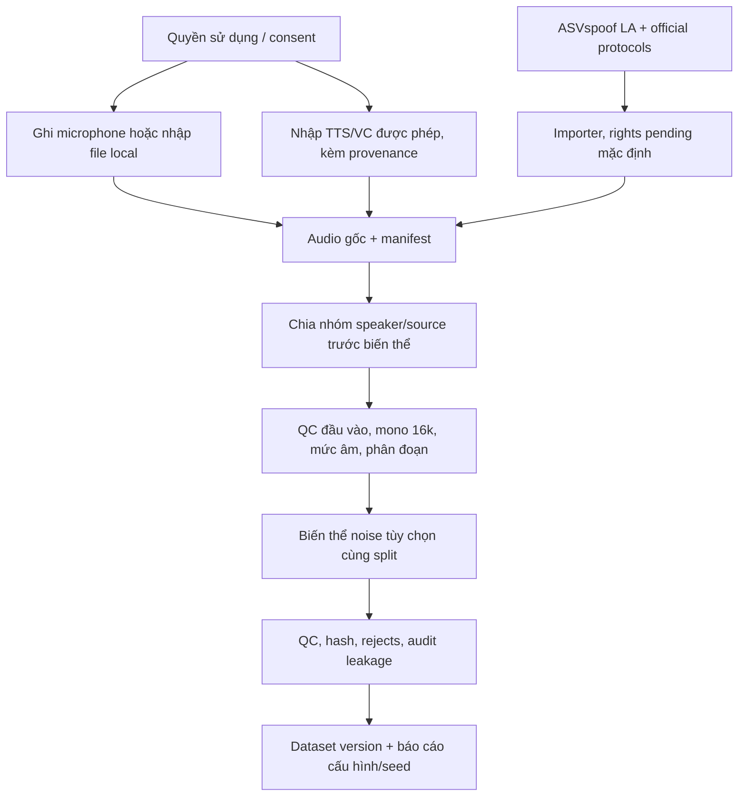

# Mã thu thập và xử lý dữ liệu để nộp

Phạm vi phiên bản này là **pipeline dữ liệu**. Huấn luyện, chất lượng detector và
checkpoint được hoãn theo yêu cầu. Các bước dưới đây là mã tái lập, không phải
tuyên bố đã thu giọng người hoặc đã có sự đồng ý của người tham gia.

## 1. Đối chiếu với ảnh pipeline

| Khối nghiệp vụ | Mã và đầu ra | Giới hạn thực tế |
|---|---|---|
| Ghi âm có đồng ý | `voicescope.collect record`: kiểm metadata/consent trước mở microphone; WAV PCM16 mono 16 kHz | Chưa ghi microphone thật trong phiên nộp; sounddevice là dependency tùy chọn |
| Tiếp nhận tiếng thật | `voicescope.collect ingest`: copy file local, giữ bytes gốc, kiểm ID/hash trùng | Chỉ WAV/FLAC; không tự crawl audio |
| TTS/chuyển đổi giọng | Nhập audio từ công cụ được phép bằng `collect ingest`, metadata `label=fake`, `synthesis_method`, lineage và quyền nguồn | Không tự sinh giọng, không có provider/credential; không giả nhận đã tạo mẫu fake |
| Audio gốc + metadata | `raw/<clip_id>.wav/flac`, `manifest.jsonl`; template trong `examples/collection.*.example.json` | Consent/license phải do người phụ trách xác minh |
| Benchmark có sẵn | `voicescope.import_asvspoof`: đọc protocol ASVspoof 2019 LA, import train/dev/eval | Mặc định rights pending; source grouping dùng speaker proxy, chưa nạp file-map recording gốc |
| Chuẩn hóa định dạng | `voicescope.audio.decode`, `voicescope.prepare`: mono, polyphase 16 kHz, WAV PCM16 | Giới hạn bytes, decoded samples, thời lượng |
| Xử lý mức âm | Kiểm NaN/Inf, peak/clipping/RMS; `peak_normalize` tùy config | Mặc định không peak-normalize; không mô phỏng AGC rồi gọi là thiết bị thật |
| Phân đoạn tiếng nói | `speech_regions` / `speech_windows`: energy gate, giữ timestamp gốc | Heuristic theo năng lượng, không phải learned VAD |
| Thiết bị/kênh tùy chọn | `prepare --augment-noise`: white noise 20 dB theo seed, lineage/split kế thừa | Chưa mô phỏng codec/replay/WebRTC NS/AGC/AEC |
| Kiểm tra chất lượng | Decode/clipping/duration/hash PCM, `rejects.jsonl`, quality mỗi clip | Near-duplicate và nghe/rà soát thủ công chưa tự động hóa |
| Chia tập theo nhóm | `assign_splits`/`audit_splits`: liên thông speaker/source/parent/related IDs | Chia trước biến thể để chống leakage; không ép tách nhóm để cân bằng lớp |
| Đóng gói có phiên bản | Thư mục output mới, `split-plan.jsonl`, `manifest.jsonl`, rejects và `prepare-report.json` | Không ghi đè dataset version; không đưa audio lên Git |



## 2. Tiếp nhận hoặc ghi âm dữ liệu riêng

Chuẩn bị metadata ngoài Git, dùng template có sẵn. Template mặc định **pending**,
không được phép xử lý cho tới khi người dùng có quyền thật và cập nhật hồ sơ.

```powershell
New-Item -ItemType Directory -Force data/private/metadata
Copy-Item examples/collection.real.example.json data/private/metadata/real001.json
```

Sửa `clip_id`, `speaker_id`, `source_id`, thiết bị/kênh, `consent_ref` và `license`
theo nguồn thực tế. Chỉ đặt `consent_status=granted` khi có hồ sơ đồng ý phù hợp;
không đặt tên người, email hoặc số điện thoại vào manifest. Không chỉnh
`is_test_fixture=false` cho tín hiệu test để giả thành dữ liệu nghiên cứu.

Nhập bản ghi có sẵn, giữ nguyên tệp nguồn:

```powershell
.\.venv\Scripts\python.exe -m voicescope.collect ingest --root data/private --metadata data/private/metadata/real001.json --file 'DUONG_DAN_FILE_WAV_CUA_BAN'
```

Ghi microphone trên máy người thu (không chạy trong cloud web service):

```powershell
.\.venv\Scripts\python.exe -m pip install -r requirements-collection.txt
.\.venv\Scripts\python.exe -m voicescope.collect record --root data/private --metadata data/private/metadata/real001.json --seconds 10 --confirm-recording
```

Có thể chỉ định `--device` là chỉ số input device của sounddevice. Mã chặn consent
pending trước khi mở microphone; OS/trình duyệt vẫn có thể yêu cầu quyền thiết bị.
[API sounddevice dùng cho rec/wait/stop](https://python-sounddevice.readthedocs.io/en/0.5.3/api/convenience-functions.html).
Mặc định mã chỉ ghi khi người dùng trực tiếp chạy lệnh record.

TTS/VC: tự tạo bằng công cụ/giọng nguồn có quyền, điền template
`examples/collection.fake.example.json`, rồi dùng cùng lệnh ingest. Bản fake phải
giữ `source_id`/`parent_clip_id` của nguồn liên quan, khai báo người nói nguồn/đích
trong `related_speaker_ids` khi VC có nhiều người nói. Thay noise/tốc độ không tự
biến một bản thật thành giọng AI. Không có bước gọi dịch vụ ngoài trong CLI này.

Collection ghi `manifest.jsonl` theo lock đơn tiến trình, chống trùng clip/hash và
cập nhật manifest bằng replace; không xóa tệp nguồn. Lỗi capture không được giả
thành audio hợp lệ. Mọi collection dưới `data/` bị loại khỏi Git.

## 3. Import ASVspoof 2019 LA

Không tải lại dữ liệu. `--root` là thư mục chứa ba tập và `ASVspoof2019_LA_cm_protocols`.
Giữ ánh xạ `bonafide→real`, `spoof→fake`, `train/dev/eval→train/validation/test`.
Attack ID giữ riêng; không đoán subtype TTS/VC nếu protocol không ghi.

Kiểm tra importer trên mẫu giới hạn (2 clip mỗi nhãn mỗi split, tối đa 12 clip):

```powershell
.\.venv\Scripts\python.exe -m voicescope.import_asvspoof --root data/benchmarks/asvspoof2019/original/LA --output data/imported/asvspoof2019-preview --limit-per-class 2
```

Mặc định manifest được tạo ở trạng thái `consent_status=pending`. Không thể chạy
prepare/train bằng manifest pending. `--limit-per-class` là kiểm tra luồng import,
không tạo benchmark đại diện hoặc kết quả mô hình.

Sau khi người phụ trách xem license/content terms trong bản tải và ghi hồ sơ quyền:

```powershell
.\.venv\Scripts\python.exe -m voicescope.import_asvspoof --root data/benchmarks/asvspoof2019/original/LA --output data/imported/asvspoof2019-v001 --rights-ref 'MA_HO_SO_KIEM_TRA_LICENSE_THUC_TE'
.\.venv\Scripts\python.exe -m voicescope.prepare --manifest data/imported/asvspoof2019-v001/manifest.jsonl --root data/benchmarks/asvspoof2019/original/LA --output data/processed/asvspoof2019-v001 --config configs/default.json
```

Importer chỉ đọc protocol và header audio; full decode/QC là bước prepare.
Device/channel ghi `not_provided`, không bịa thông tin. `source_id` hiện dùng nhóm
speaker bảo thủ vì chưa nạp original-recording file-map: đủ giữ nhóm speaker trong
protocol này, **chưa chứng minh source-disjoint khi trộn nhiều benchmark**.
Khi pooling ASVspoof 2019/2021 hoặc corpus liên quan cần nhập file maps gốc và audit
lại nguồn. [Nguồn ASVspoof 2019 và file maps](https://www.asvspoof.org/index2019.html).

Vietnam-Celeb là corpus real phục vụ nhận dạng người nói. V1 chưa có importer
Vietnam-Celeb và chưa gán nhãn fake cho corpus này. Không đưa trực tiếp các trial
speaker-verification thành nhãn Real/Fake. Không trộn nguồn benchmark vào private data.

## 4. Chạy xử lý collection và kiểm tra đầu ra

```powershell
.\.venv\Scripts\python.exe -m voicescope.prepare --manifest data/private/manifest.jsonl --root data/private --output data/processed/private-v001 --config configs/default.json --augment-noise
```

Nếu không cần noise, bỏ `--augment-noise`. Cần ít nhất 3 nhóm độc lập để tự chia;
thiếu nhóm thì thu thêm, không phá grouping. Nếu đã có split đủ mọi dòng, giữ split
và audit trước sinh biến thể. Seed và toàn bộ config lưu trong report.

Đầu ra phải kiểm tra: `split-plan.jsonl`, `manifest.jsonl`, `rejects.jsonl`,
`prepare-report.json`, audio trong `audio/`. Mỗi đoạn có start/end gốc, hash,
parent, nhãn và split. Nghe mẫu, xem report và rà reject trước giai đoạn train.
Giai đoạn này không có checkpoint, accuracy/F1/EER hoặc kết luận phát hiện thật.

## 5. Cách người chấm kiểm tra mà không có corpus riêng

```powershell
.\.venv\Scripts\python.exe -m pip install -r requirements-dev.txt
.\.venv\Scripts\python.exe -m pytest tests/test_core.py tests/test_collect.py tests/test_import_asvspoof.py tests/test_prepare.py tests/test_pipeline_rejects.py -q
```

Tests chỉ sinh tín hiệu sin/zero/clipping trong temp, mọi fixture mang nhãn test
và không được train sử dụng. Test record dùng hàm giả lập thiết bị trong test,
không mở microphone và không được gọi là đã thu âm thật. Mã nộp không kèm corpus,
metadata riêng, checkpoint hoặc các bản archive hàng GB.
Importer hỗ trợ `--test-fixture` cho protocol/audio tổng hợp trong tests; đầu ra
có cờ fixture và bị chặn khỏi train. Không dùng cờ này cho corpus benchmark thật.
